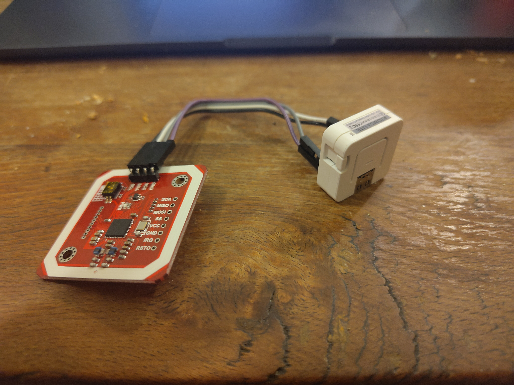

# Secure NFC Reader: Phase 0

Initial prototyping work focuses on procuring hardware and validating it.

## Phase 0: Read UIDs with PN532

With a PN532 and M5Stack AtomS3 Lite i was able to validate reading of UIDs from various tags with the following setup.

This setup was able to
* read UIDs from insecure cards
* read UIDs from secure (third party) cards, while complaining about a missing NFED structure

All of this via default ESPHome integration over i2c.

The next steps will be
* check if raw access is possible over SPI or HSU
* re-evaluate tne PN532 chip and consider replacing it with an ST25R3916 that is also readily available
* figure out if the door-side part can be implemented witout an active MCU on the insecure side
